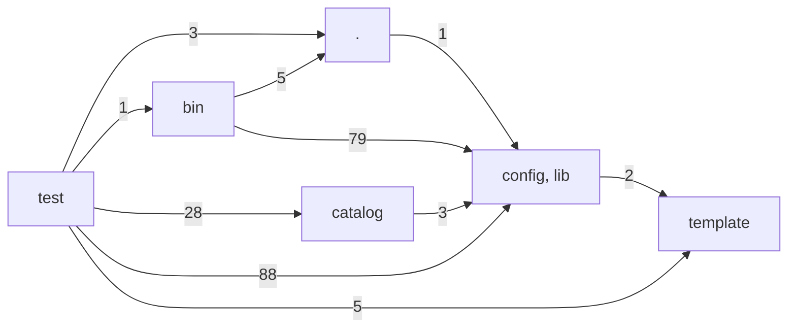

# Layers

## config, lib

| Forbidden import | Message                                                                 |
| ---------------- | ----------------------------------------------------------------------- |
| `^(\.\./)+bin/`  | `Keep command entry points in bin. Put reusable code in lib or config.` |
